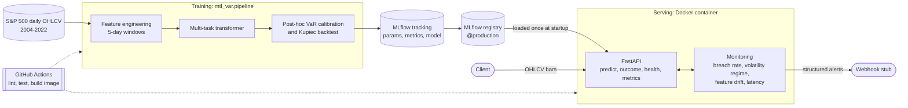

# mtl-var

[](https://github.com/ManasviMenon/Multi-Task-Model-with-Transformers/actions/workflows/ci.yml)
[](https://mlflow.org)

**A Value-at-Risk calibration that passes in one market regime fails in the next — and no static configuration
fixes it.** This project tests that on S&P 500 daily data from 2004 to 2022 with a multi-task transformer, then
runs the model the way a production system would: tracked experiments, a model registry, a served API, drift
monitoring, a container image and CI.

## The finding

- **Calibration does not transfer across regimes.** A frozen post-hoc calibration offset fails the Kupiec
  backtest in 4 of 5 regime-aligned walk-forward folds (2008, 2011, 2015, 2020). The one pass, 2022, has the
  shortest evaluation window.
- **No static configuration fixes it.** Rolling recalibration rescues four folds but not 2008. A 40-day
  calibration window rescues 2008 but breaks 2020, and no window length passes every fold.
- **It is not specific to the model.** A model-free historical-simulation VaR fails all five folds under the
  same calibration protocol.
- **So calibration has to be watched, not trusted.** Replayed day by day through the live service, a standard
  250-day backtest window read "on target" in the middle of the COVID crash, while that phase breached at 20%.

The feature set was corrected during development to remove target leakage; all reported results use the
leakage-free model, and the central calibration finding holds independently of this correction.

Full write-up: [`RESULTS.md`](RESULTS.md).

## Architecture



**The model.** A multi-task transformer reads 5-day windows of 18 engineered daily features: a 64-dimensional
projection, four transformer blocks (4 attention heads, key dimension 128), global average pooling, and five
linear heads — next-day log-return, log-volume, range-based volatility, 5% VaR and 5% CVaR. VaR is trained with
pinball loss at q=0.05, with all targets standardised and weighted equally. A post-hoc additive offset turns the
VaR head into the calibrated VaR the API serves.

**Limits worth knowing.** The return head does not beat a zero forecast, so the model is for risk — volatility,
VaR and CVaR — not return prediction. The served model's calibration is fitted on 2022; given the finding above,
treat its VaR as calibrated only for conditions resembling that window.

## Quickstart

```bash
pip install -e ".[dev]"    # install the package, pinned dependencies and dev tools
pytest                     # run the test suite
mtl-var serve              # start the API on http://127.0.0.1:8000
```

A fresh clone has no registered model yet, so `/health` reports `degraded` until you train and register one
(training takes about nine minutes on a CPU):

```bash
mtl-var train                               # train the served model and log it to MLflow
mtl-var register-model --alias production   # register it and point @production at it
```

Restart `mtl-var serve` and `/health` reports `ok`. [`scripts/drift_demo.py`](scripts/drift_demo.py) is a
complete example client for `/predict` and `/outcome`.

To run the container instead, build it after registering a model — a local build bakes in the registry:

```bash
docker build -t mtl-var . && docker run -p 8000:8000 mtl-var
```

## MLOps stack

| Layer | Implementation |
|---|---|
| Packaging | Installable `mtl_var` package with pinned dependencies, an `mtl-var` CLI, and fixed seeds for deterministic runs |
| Experiment tracking | MLflow on a local SQLite backend — one run per fold and seed, with parameters, metrics and the model artifact |
| Model registry | MLflow registry addressed by alias; each version records its git commit, data hash, fold and seed |
| Serving | FastAPI with Pydantic validation: `POST /predict`, `POST /outcome`, `GET /health`, `GET /metrics`, and per-request latency |
| Containerisation | Multi-stage Docker image, non-root user, built-in health check |
| Monitoring | Rolling breach rate with a Kupiec test, a volatility-regime signal, feature drift and latency percentiles, with deduplicated structured alerts |
| CI | GitHub Actions on every push: ruff, pytest, and a Docker build with a `/health` smoke test |

Browse runs and registered versions with `mlflow ui --backend-store-uri sqlite:///mlruns/mlflow.db`.

## Drift monitoring and the retrain trigger

The monitor runs inside the serving process. As realised returns arrive through `POST /outcome` it scores each
earlier forecast, tracking the rolling VaR breach rate against the 5% target with a Kupiec test. It also watches
whether live volatility has left the regime the calibration was fitted in, and whether inputs have drifted from
the training distribution. Alerts fire on state changes rather than on every request, and a webhook stub shows
where they would be sent.

In production, alerts would route to the cheapest action that addresses them:

- **A volatility-regime shift** triggers a recalibration of the offset on recent data — no new model.
- **A rejected calibration** opens a retrain job: the same tracked pipeline, run on newer data.
- **Sustained feature drift** is investigated first, then retrained if it is real.

A retrained candidate is registered at `@staging` and promoted only if it beats production on recent
walk-forward windows, with a human moving the alias. Promotion stays manual on purpose: no static configuration
survived every regime, and an automatic loop would chase whichever window broke last. Retraining is designed
here, not automated.

A day-by-day replay through the live service confirmed the monitor stays quiet on the model's own out-of-sample
year. It also exposed weaknesses in the monitor itself — the long backtest window that masked the COVID crash, a
volatility alert that fired only after the crash began, a feature-drift signal too noisy to act on, and alerts
that flap around their thresholds. Each has a proposed fix with an acceptance criterion, deliberately not tuned
to the replay. Details: [`docs/MONITORING.md`](docs/MONITORING.md).

## Continuous integration

Every push and pull request runs two jobs: lint and test, and a Docker build that starts the container and
checks `/health`. A clean checkout has no registered model, so the handful of serving tests that need one skip
with their reason printed, and the smoke test accepts a `degraded` start. This is integration only — nothing is
deployed.

## Repository layout

```
src/mtl_var/   the package: data, model, calibration, backtest, pipeline, tracking, registry, serving, monitoring, CLI
tests/         pytest suite
scripts/       the experiments behind RESULTS.md, and the drift replay
results/       recorded results and prediction caches
docs/          monitoring and retrain-trigger design
RESULTS.md     full research write-up
```
