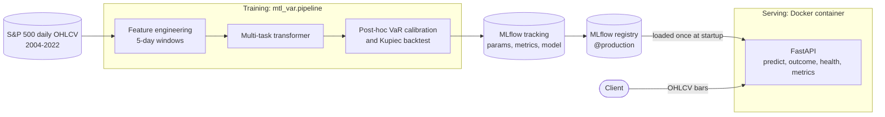

# mtl-var

[](https://github.com/ManasviMenon/Multi-Task-Model-with-Transformers/actions/workflows/ci.yml)
[](https://mlflow.org)

A Value-at-Risk calibration that passes in one market regime fails in the next, and no static configuration
fixes it. This project tests that on S&P 500 daily data from 2004 to 2022 with a multi-task transformer, then
packages the model with experiment tracking, a model registry, a served API and a container image.

## The finding

- Calibration does not transfer across regimes. A frozen post-hoc calibration offset fails the Kupiec backtest
  in 4 of 5 regime-aligned walk-forward folds (2008, 2011, 2015, 2020). The one pass, 2022, has the shortest
  evaluation window.
- No static configuration fixes it. Rolling recalibration rescues four folds but not 2008. A 40-day
  calibration window rescues 2008 but breaks 2020, and no window length passes every fold.
- It is not specific to the model. A model-free historical simulation VaR fails all five folds under the same
  calibration protocol.
- A long backtest window can hide the problem. Replayed day by day, a rolling 250-day window still showed
  about 5% coverage during the COVID crash, while that phase breached at 20%.

The feature set was corrected during development to remove target leakage; all reported results use the
leakage-free model, and the central calibration finding holds independently of this correction.

Full write-up: [`RESULTS.md`](RESULTS.md).

## Architecture



The model reads 5-day windows of 18 engineered daily features. A 64-dimensional projection feeds four
transformer blocks (4 attention heads, key dimension 128), then global average pooling and five linear heads:
next-day log-return, log-volume, range-based volatility, 5% VaR and 5% CVaR. VaR is trained with pinball loss
at q=0.05, and all targets are standardised and weighted equally. A post-hoc additive offset turns the VaR
head into the calibrated VaR the API serves.

Two limits are worth stating. The return head does not beat a zero forecast, so the model is useful for risk
(volatility, VaR, CVaR) rather than for predicting returns. The served model's calibration is fitted on 2022,
so its VaR should be treated as calibrated only for conditions resembling that window.

## Quickstart

```bash
pip install -e ".[dev]"    # install the package, pinned dependencies and dev tools
pytest                     # run the test suite
mtl-var serve              # start the API on http://127.0.0.1:8000
```

A fresh clone has no registered model, so `/health` reports `degraded` until you train and register one.
Training takes about nine minutes on a CPU:

```bash
mtl-var train                               # train the served model and log it to MLflow
mtl-var register-model --alias production   # register it and point @production at it
```

Restart `mtl-var serve` and `/health` reports `ok`. [`scripts/drift_demo.py`](scripts/drift_demo.py) shows a
complete `/predict` and `/outcome` request cycle.

To run the container instead, build it after registering a model, since a local build includes the registry:

```bash
docker build -t mtl-var . && docker run -p 8000:8000 mtl-var
```

## MLOps stack

| Layer | Implementation |
|---|---|
| Packaging | Installable `mtl_var` package, pinned dependencies, an `mtl-var` CLI, and fixed seeds for deterministic runs |
| Experiment tracking | MLflow on a local SQLite backend, one run per fold and seed, with parameters, metrics and the model artifact |
| Model registry | MLflow registry addressed by alias. Each version records its git commit, data hash, fold and seed |
| Serving | FastAPI with Pydantic validation: `POST /predict`, `POST /outcome`, `GET /health`, `GET /metrics`, and per-request latency |
| Containerisation | Multi-stage Docker image, non-root user, built-in health check |
| Monitoring | Rolling breach rate with a Kupiec test, volatility-regime and feature-drift signals, and latency percentiles |

Browse runs and registered versions with `mlflow ui --backend-store-uri sqlite:///mlruns/mlflow.db`.

## Repository layout

```
src/mtl_var/   the package: data, model, calibration, backtest, pipeline, tracking, registry, serving, monitoring, CLI
tests/         pytest suite
scripts/       the experiments behind RESULTS.md, and the replay client
results/       recorded results and prediction caches
docs/          design notes
RESULTS.md     full research write-up
```
